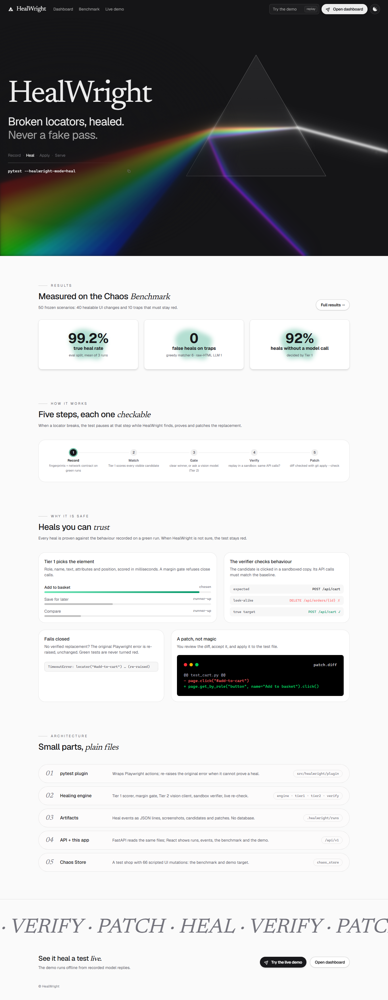
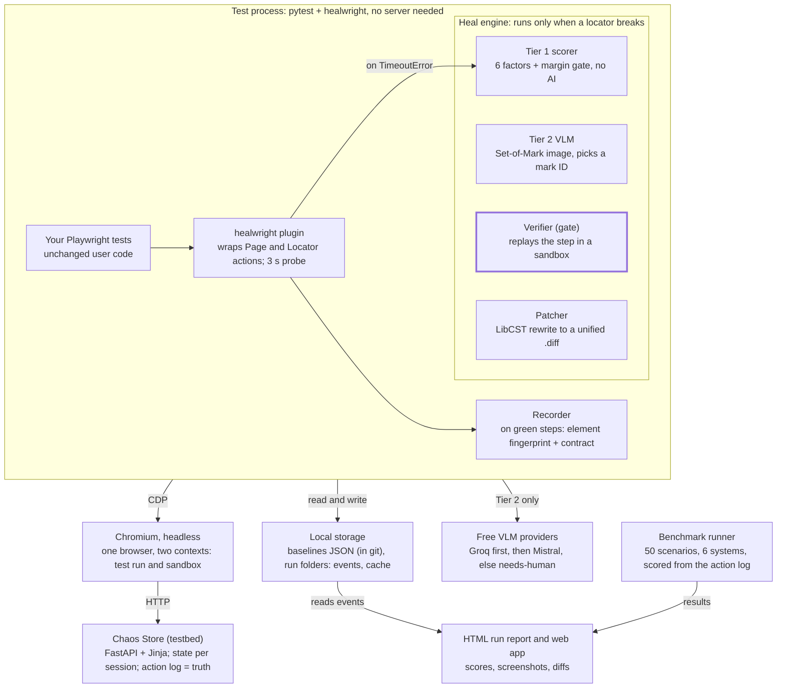
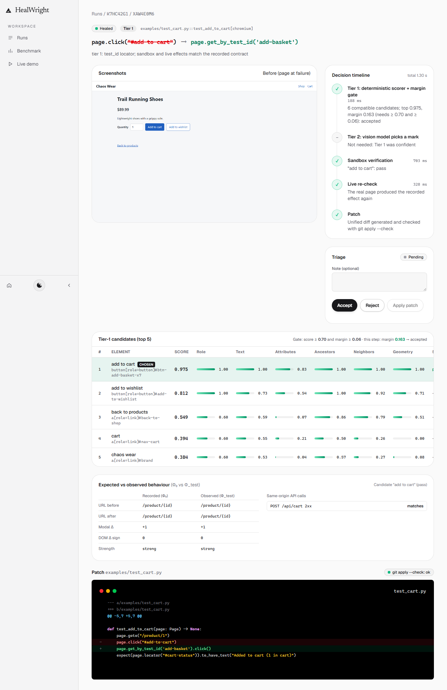

# HealWright

**Self-healing Playwright selectors that never fake a pass.**

HealWright is a pytest-playwright plugin for Python tests. When a selector breaks because of a harmless UI change (a renamed id, a CSS refactor, a reworded button, a translated page), HealWright finds the element the test meant, **proves the replacement does the same thing**, lets the test continue and writes a patch for you to review. If it cannot prove it, the original Playwright error is raised unchanged and the test stays red.



## Why

Most self-healing tools pick the element that looks most similar. That is dangerous: when a feature is removed, or a look-alike button (Cancel next to Confirm) takes the old button's place, a greedy healer clicks the wrong thing and turns a real bug green. HealWright treats a heal as a claim that needs evidence.

## How it works

1. **Record.** On green runs, HealWright stores a fingerprint of every element a test touches (role, accessible name, text, attributes, ancestors, neighbours, position) and a **behaviour contract** for the action: URL before and after, same-origin API calls, modal and DOM changes. Baselines live in `.healwright/baselines/` and are committed with your tests.
2. **Match (Tier 1).** When a selector fails, a deterministic scorer ranks every visible candidate on six features. No AI, a few milliseconds.
3. **Gate.** The top candidate is accepted only if its score is high **and** clearly ahead of the runner-up. Close calls go to Tier 2: a vision model is shown a screenshot with numbered marks and may only answer with a mark number, never with code.
4. **Verify.** The candidate's action is replayed in an isolated browser context. Its observed effects must match the recorded contract, or the heal is refused.
5. **Patch.** The test continues, and a unified diff that replaces the old selector with a robust locator is generated and checked with `git apply --check`. You review it in the web app and apply it with `healwright apply`.

Healed runs never update baselines, so a bad heal cannot poison future runs.

## Architecture

Healing happens inside the pytest process. The HTML report, the web app and every free-tier model provider sit outside a test's critical path, so any of them can fail without changing a test's outcome.



## Results

Measured on the **Chaos Benchmark**: a test shop with scripted UI mutations, and 50 frozen evaluation scenarios (40 healable changes and 10 traps that must stay red). The eval set was frozen before any tuning. Every number below is generated from `benchmark/results/`; method and details are in [`docs/BENCHMARK.md`](docs/BENCHMARK.md).

| System | Runs | True heal rate | False heals on traps (per run) | Precision | Tier-1 share |
| --- | --- | --- | --- | --- | --- |
| Native Playwright | 1 | 0% | 0 | n/a | n/a |
| Greedy matcher (top-1, no gate, no verifier) | 1 | 100% | 6 | 87.8% | 100% |
| Raw-HTML LLM | 3 | 95% | 1 | 97.7% | 0% |
| Tier 1 only (ablation) | 1 | 97.5% | 0 | 100% | 100% |
| No verifier (ablation) | 3 | 100% | 3 | 93.5% | 91.5% |
| **HealWright** | 3 | **99.2%** | **0** | **100%** | 92% |

- Zero false heals on traps in every HealWright run. With the same model answers and the verifier switched off, 3 traps turn green the wrong way per run.
- 92% of heals need no model call.
- Every HealWright heal produced a patch that passes `git apply --check` (137 of 137 healed events).
- Known limitation: recording on green runs costs 21.3% extra suite time (median, examples suite); the target was under 10%.

## Quick start

Requirements: Python 3.11 and [uv](https://docs.astral.sh/uv/), Git, and Node.js LTS only if you want to build the web app.

```bash
uv sync --locked
uv run playwright install chromium
uv run pytest -m "unit or integration" -q
```

Use it on a test suite:

```bash
uv run pytest tests/ --healwright-mode=record   # green runs: save fingerprints and behaviour contracts
uv run pytest tests/ --healwright-mode=heal     # a selector broke: heal, verify, patch
uv run healwright report <run_id>               # self-contained HTML report of one run
uv run healwright apply <event_id>              # apply a reviewed patch (source hash + git apply --check)
```

Tier 2 is optional. Copy `.env.example` to `.env` and add a free-tier key (`GROQ_API_KEY`; optionally `MISTRAL_API_KEY` or `GEMINI_API_KEY`). Without keys, Tier 1 still heals, and the benchmark and demo run offline in **replay** mode using the recorded model replies in `benchmark/vlm_cache/`.

## Web app and live demo

```bash
cd frontend && npm ci && npm run build && cd ..
uv run healwright serve        # http://127.0.0.1:8000
```

Browse runs and heal events (screenshots, candidate scores, recorded versus observed behaviour, the patch), accept or reject a heal, see the benchmark, and run the live demo: break the test shop, run the real test, and watch HealWright heal it or refuse a trap.



## Benchmark

```bash
uv run python -m benchmark.run --split dev --system healwright --vlm-mode replay
uv run python -m benchmark.run --split eval --providers groq --system <system> --vlm-mode replay --tag <tag>
uv run python -m benchmark.combine
```

Systems: `native`, `greedy`, `rawhtml`, `tier1_only`, `healwright_noverify`, `healwright`.

## Repository layout

| Path | Contents |
| --- | --- |
| `src/healwright/` | The plugin and engine: `recorder`, `tier1`, `tier2`, `verify`, `locators`, `patcher`, `plugin`, `store`, `api`, `report`, `cli` |
| `chaos_store/` | The Chaos Store test shop (FastAPI) and its mutation scenarios |
| `examples/` | Example Playwright test suite against the Chaos Store |
| `benchmark/` | Benchmark runner, frozen eval set, results and recorded model replies |
| `frontend/` | Web app (Vite, React, TypeScript, Tailwind) |
| `tests/` | Unit, integration, UI and release-gate tests |
| `docs/` | API, benchmark method and results, runbook, measurements, screenshots |

More: [`docs/API.md`](docs/API.md), [`docs/BENCHMARK.md`](docs/BENCHMARK.md), [`docs/RUNBOOK.md`](docs/RUNBOOK.md).

## Authors

Zaid Bin Naveed, Muhammad Abbas and Muhammad Sabeeh.

## License

MIT, see [`LICENSE`](LICENSE). Third-party UI code and fonts: [`THIRD_PARTY_NOTICES.md`](THIRD_PARTY_NOTICES.md).
